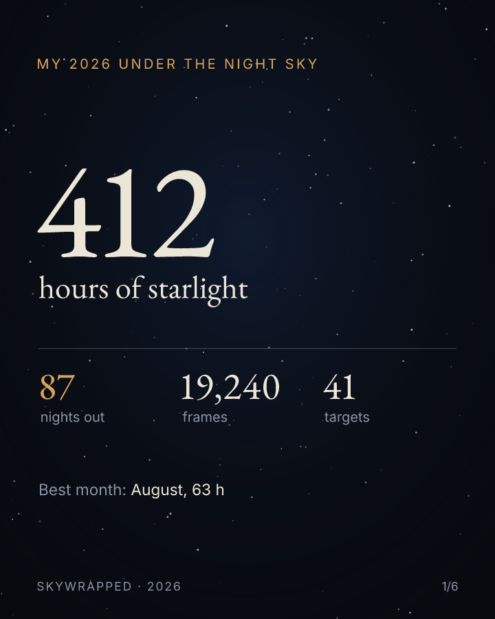
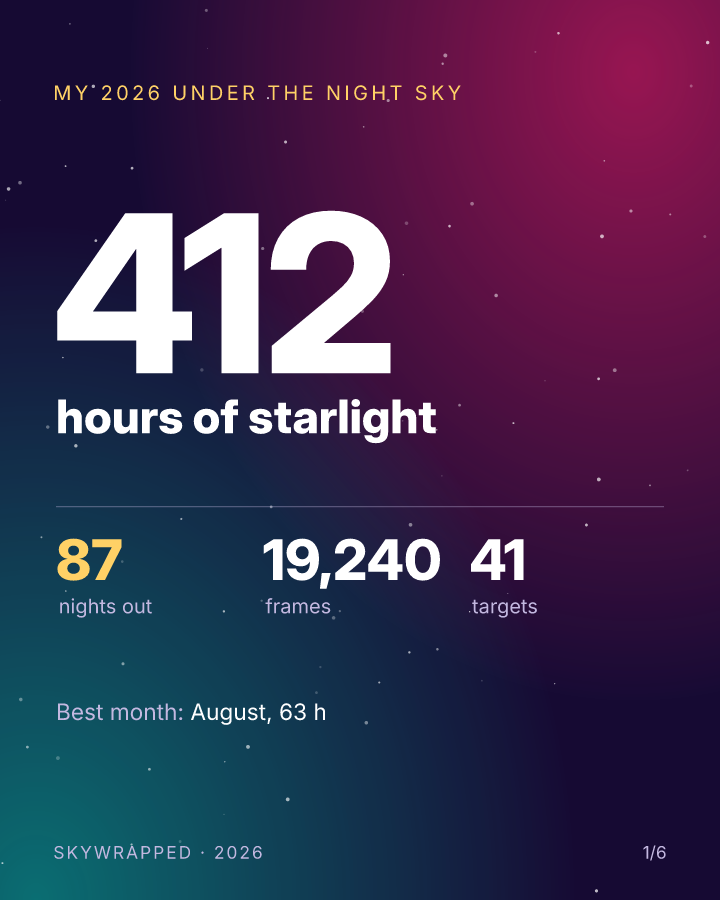

# skywrapped

Turn a folder of astrophotography light frames into "year in astro" cards, reading FITS headers only.




The two cards above come from an invented sample: made-up totals, generic rigs and invented hours on well-known
targets over random nights. It is nobody's real observing log.
A run makes six portrait cards (cover, night calendar, top targets, journey, records, gear), a landscape poster, a
`summary.json` and a small `index.html` to flip through them.

## Try it in the browser

https://aousabdo.github.io/skywrapped/

Pick your lights folder and the cards are made on your computer. Nothing is uploaded.

## Install and run

You need Python 3.10 or newer. Use whichever of these three you have; each one makes the same cards.

With pip:

```bash
pip install "skywrapped[cli]"
skywrapped ~/Astro/Lights
```

With [uv](https://docs.astral.sh/uv/), without installing anything:

```bash
uvx --from "skywrapped[cli]" skywrapped ~/Astro/Lights
```

With [pipx](https://pipx.pypa.io/), without installing anything:

```bash
pipx run --spec "skywrapped[cli]" skywrapped ~/Astro/Lights
```

Replace `~/Astro/Lights` with your own lights folder (on Windows, a path like `D:\Astro\Lights`). You can give
several folders or single files, and subfolders are searched. The cards land in a new `skywrapped-<year>` folder
inside the folder you ran the command from; open its `index.html` to flip through them.

If `pip install` stops with "externally-managed-environment" (Homebrew Python on a Mac, many Linux systems), use
`uvx` or `pipx` instead, or install into a virtual environment.

If your rejected subs sit in their own folders, leave them out: `--exclude '*/rejected/*'`.

FITS (`.fit`, `.fits`, `.fts`), `.fz` and XISF files are read. Gzipped files (`.fits.gz`) are not read: decompress
them first. The `cli` extra adds the PNG renderer; without it, use `--json-only`.

| Option | What it does |
|---|---|
| `--year N` | Count calendar year N (default: this year). |
| `--all` | Count every year. |
| `--theme observatory\|nebula` | Card look (default `observatory`). |
| `--out DIR` | Output folder (default `./skywrapped-<year>`, or `./skywrapped-all` with `--all`). |
| `--exclude GLOB` | Skip matching paths. Repeat for more than one. |
| `--tz HOURS` | Your UTC offset in hours, e.g. `-5` or `5.5`, used for working out nights (default: this computer's). |
| `--json-only` | Write `summary.json` only. |
| `--version` | Print the version. |

### The output folder

skywrapped writes a marker file (`.skywrapped-output`) into the folder it makes. On a later run into the same
folder it replaces only its own files (`card-*.png`, `card-*.svg`, `poster.*`, `index.html`, `summary.json`) and never
mixes two runs. It refuses a folder that already has other files in it and has no marker.

## Privacy

Only header bytes are read; pixel data is never touched, and nothing leaves your computer (the web page runs the
same code in your browser). Your location, your file names and the free-text object names in the headers are never
shown on a card, and telescope and camera names are printed without device ids or serial numbers.

## Tested with

ASIAIR, Celestron Origin, N.I.N.A., ZWO Seestar, Dwarf 3 and Ekos/KStars. Each has a header fixture in the test suite
(`skywrapped.TESTED_VENDORS`; details in [docs/vendors.md](https://github.com/aousabdo/skywrapped/blob/main/docs/vendors.md)). SharpCap and Vaonis Vespera have no
real sample to test against yet; their files are read as generic FITS and usually work.

## Data credits

The deep-sky catalogue, the distances and the fonts come from other people's work: OpenNGC (CC-BY-SA 4.0), VizieR
catalogues, SIMBAD distances, Baumgardt and Vasiliev's globular-cluster data, and the EB Garamond and Inter fonts
(SIL OFL). The exact sources and licences are in [LICENSE-DATA.md](https://github.com/aousabdo/skywrapped/blob/main/LICENSE-DATA.md).

## Licence

The code is MIT (see [LICENSE](https://github.com/aousabdo/skywrapped/blob/main/LICENSE)). The bundled data files keep their own licences, listed in
[LICENSE-DATA.md](https://github.com/aousabdo/skywrapped/blob/main/LICENSE-DATA.md).
